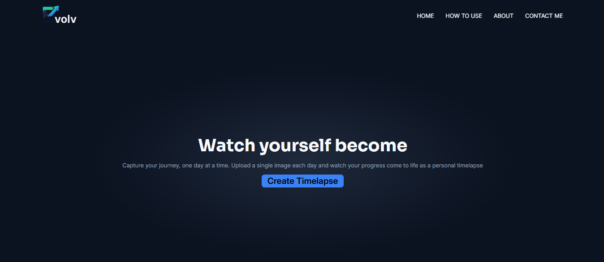
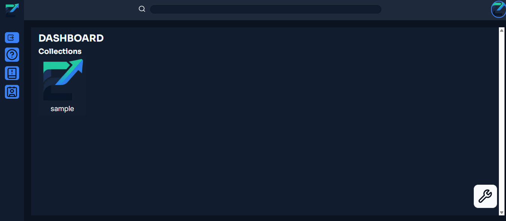
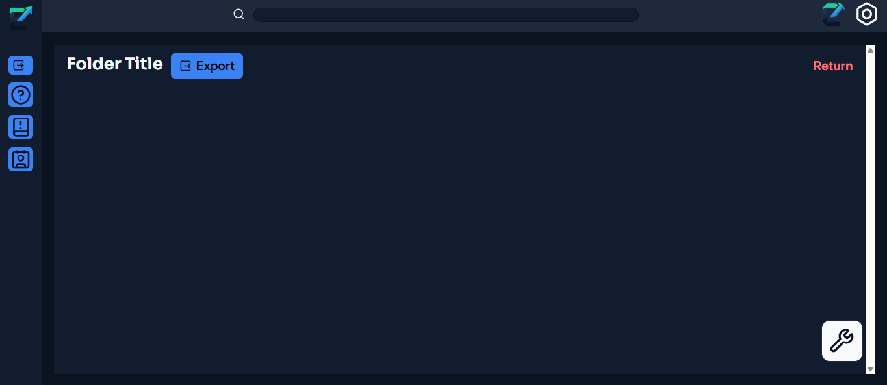
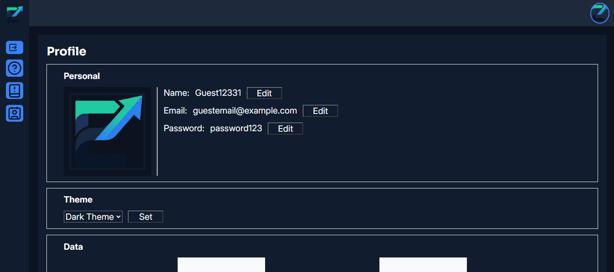

## Features

### Authentication & Account Management

- User registration and login
- Profile editing and account information management
- Account deletion
- User Data factory reset

### Personalization

- Theme customization (Light/Dark mode)

### Photo Management

- Daily photo uploads
- Image gallery
- Photo organization
- Timelapse generation
- Timelapse video downloads

### Communication

- Contact form for user inquiries and feedback using EmailJS

## Technologies Used

- HTML5
- CSS3
- JavaScript
- Supabase
- PostgreSQL
- Git
- GitHub

## Screenshots

### Landing Page

### Dashboard

### Gallery

### Profile

